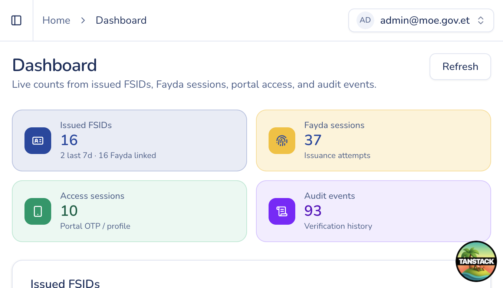

# Dashboard

## Purpose

High-level counts and charts for NSID activity so MoE staff can spot volume and status at a glance.

## Who sees it

Every authenticated user. Charts and NSID metrics appear when you have `fsid:read`. Institution-only users may see institution-oriented stats instead of the full MoE dashboard.

## How to open

Sidebar → **Dashboard** (`/dashboard`).

## Actions

1. Review summary cards (assignments, sessions, recent issuance windows).
2. Use **Refresh** (if shown) to reload statistics.
3. Open related lists from cards or charts when links are available (for example NSIDs or institutions).
