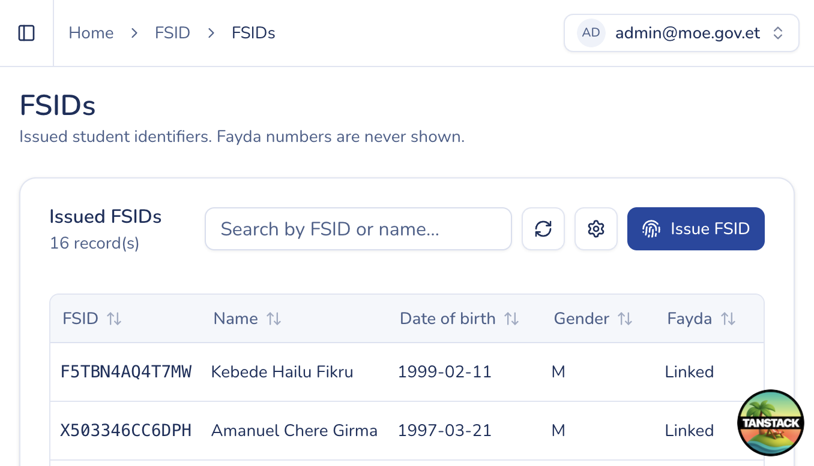

# NSIDs

## Purpose

Browse and open issued NSID assignments. Raw Fayda (FIN) numbers are not shown in staff views.

## Who sees it

Users with `fsid:read`.

## How to open

Sidebar → **NSID** → **NSIDs** (`/fsids`).

## Actions

1. **Search** by name or NSID value using the search box.
2. **Reload** the table when you need fresh data.
3. Open a row to view **NSID detail** (identity summary, Fayda linked flag, issuing institutions, access sessions, audit events).
4. Click **Issue NSID** (requires `fsid:issue`) to start a new admin issuance — see [Issue NSID](issue-fsid.md).

### Detail page notes

- Issuing institutions lists every institution link for that NSID.
- Access sessions and audit events are read-only lists for support and investigation.
