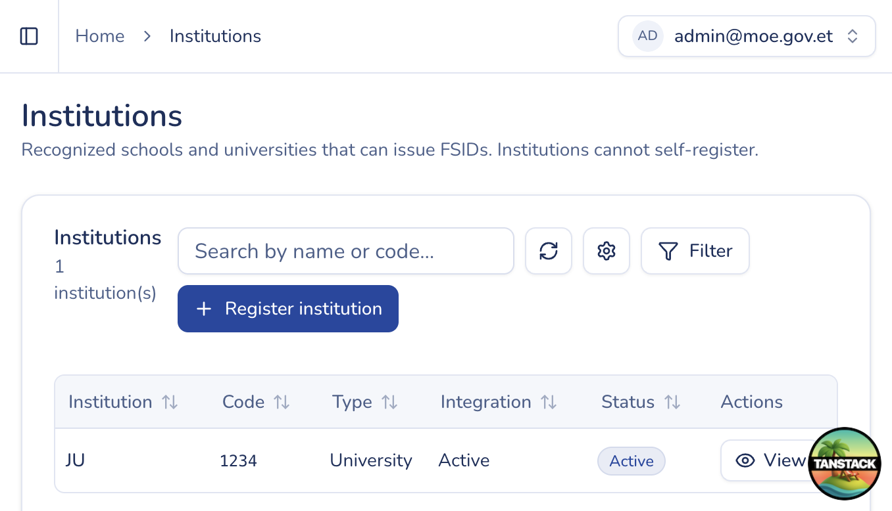
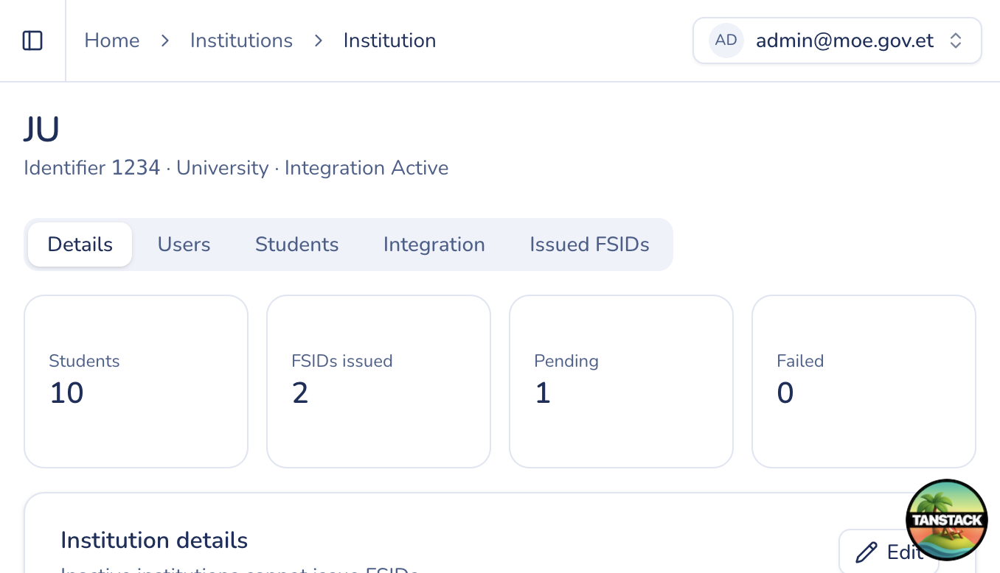

# Manage institutions

## Purpose

Register and maintain education institutions, their users, student rosters (admin view), and API integrations.

## Who sees it

Users with `institution:manage`.

## How to open

Sidebar → **Institutions** → **Manage institutions** (`/institutions`).

## List actions

1. **Search / filter** institutions.
2. **Reload** the table.
3. Click **Register institution** to open the create form (`/institutions/new`).
4. Open a row to open **institution detail**.

## Register institution

1. Enter **name**, **code**, **type**, and active status as required.
2. Save. The institution appears in the list.

## Institution detail

Typical tabs / sections:

### Details

1. Review institution fields.
2. **Edit** and **Save** when you need to update name, code, type, or active flag.

### Users

1. **Invite user** to this institution (email / membership).
2. **Activate** or **deactivate** memberships when staff leave or return.

### Students

1. Browse the institution’s roster (scoped to that institution).
2. **Export CSV** with optional field and NSID filters.
3. **Import CSV** — opens the admin import flow for this institution.
4. **Add student** to create a single roster row (student number is unique per institution).

### Integration

1. **Create integration** to issue client credentials for a SIS.
2. Copy the client secret when shown (it is displayed once).
3. Toggle integration **active / inactive**.

### Issued NSIDs

Review NSIDs already linked to this institution.
