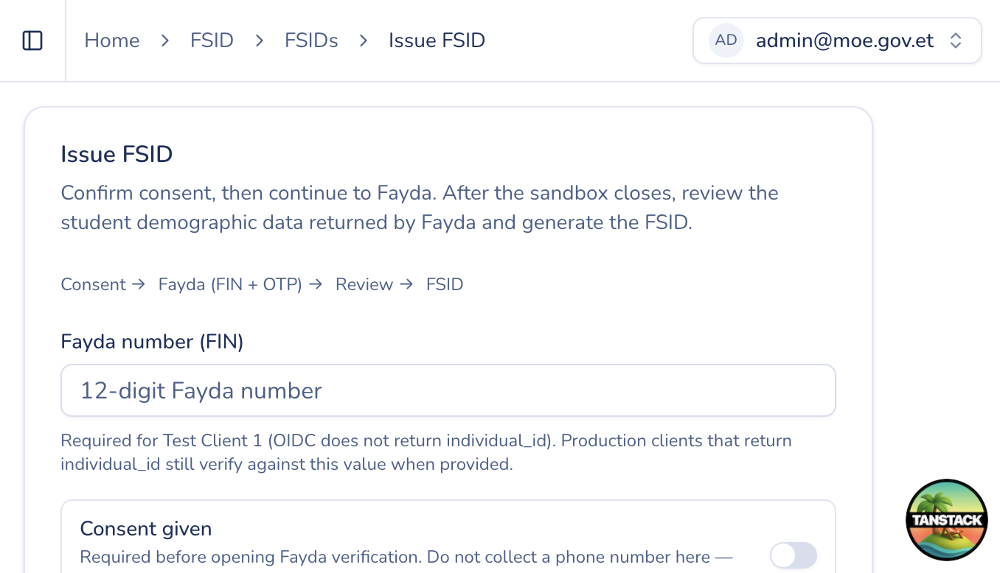

# Issue FSID (MoE admin)

## Purpose

Issue an FSID for a person through Fayda verification using the **ADMIN** channel (no institution roster required).

## Who sees it

Users with `fsid:issue`.

## How to open

Sidebar → **FSID** → **Issue FSID** (`/fsids/issue`).

## Steps

1. Confirm **consent** is recorded as required by the form.
2. Enter the person’s **FIN** (Fayda) when prompted.
3. Continue to **open Fayda verification** (redirect / popup depending on environment).
4. After verification succeeds, **review demographics** returned from Fayda (name, date of birth, gender, photo when available).
5. Click **Generate FSID** to create or retrieve the lifelong FSID.
6. Optionally continue to issue for another person.

## Tips

- If Fayda verification fails or the session expires, start a new issuance from this page.
- Track in-progress attempts under [Fayda sessions](fayda-sessions.md).
