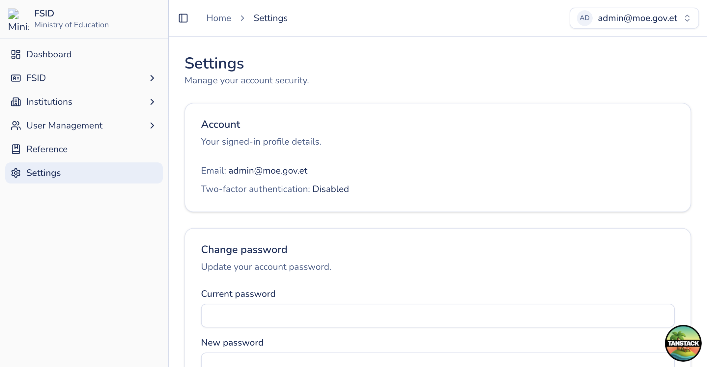

# Settings (MoE admin)

## Purpose

View your signed-in account and manage password / 2FA for your own user.

## Who sees it

All authenticated users.

## How to open

Sidebar → **Settings** (`/settings`).

## Actions

1. Review account identity (email and roles as displayed).
2. **Update password** with current and new password fields.
3. **Disable 2FA** only if your policy allows and the control is shown — prefer keeping 2FA enabled for admin accounts.
