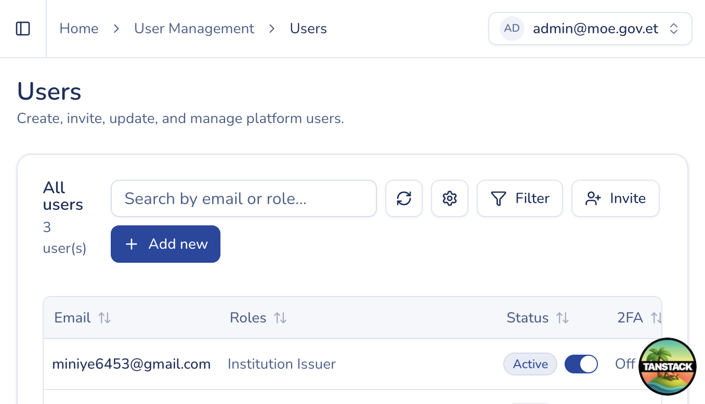

# Users

## Purpose

Manage MoE and staff user accounts: list, invite, create, edit, activate/deactivate, and delete (subject to your permissions).

## Who sees it

- List / roles: `user:read`
- Invite / create: `user:create`
- Update actions: `user:update` (as configured)

## How to open

Sidebar → **User Management** → **Users** (`/users`).

## List actions

1. **Search / filter** users.
2. Open **Invite** or **Add new** when you have create permission.
3. On a row: **Edit**, activate/deactivate, or **Delete** when available.

## Invite a user

Sidebar → **User Management** → **Invite** (`/users/invite`), or use the invite button from the users list / institution detail.

1. Enter the invitee’s **email** and role / institution membership as required by the form.
2. Send the invitation. The user completes activation from their email link.

## Create or edit a user

1. **Create**: `/users/new` — fill account fields and save.
2. **Edit**: open a user → **Edit** (`/users/{id}/edit`) — update fields and save.
