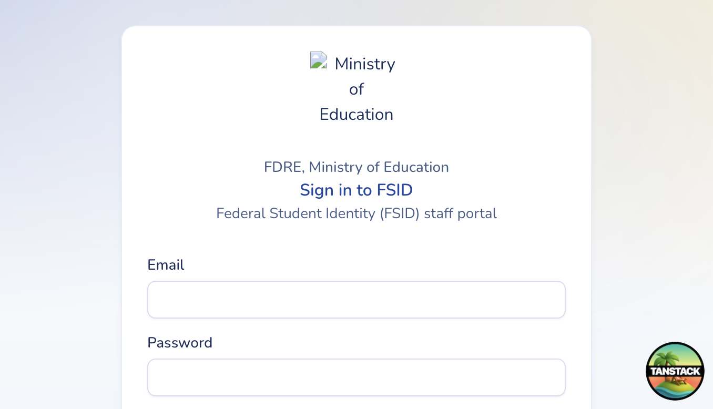

# Getting started

## Sign in

1. Open the staff console (local default: `http://localhost:3000/admin/`).
2. Enter your **email** and **password**.
3. If your account requires two-factor authentication, complete **Setup 2FA** or **Verify 2FA** when prompted.
4. After a successful sign-in you land on **Dashboard**.

### Other account flows

| Action | Where |
|---|---|
| Forgot password | Link on the login page → email reset link |
| Activate invited account | Link from your invitation email (`/activate`) |
| Sign out | User menu in the header → Sign out |

## What you see in the sidebar

Menus are **permission-based**. You and a colleague may see different items after the same login URL.

| If you have… | You typically see… |
|---|---|
| MoE admin permissions (`institution:manage`, `fsid:*`, `user:*`) | Dashboard, **FSID** group, **Manage institutions**, **User Management**, Reference, Settings. Institution portal links are **hidden**. |
| Institution permissions (`institution:read` / `institution:issue`) without manage | Dashboard, **Institution portal**, **Students** (if you can issue), Settings |

### Permission cheatsheet (sidebar)

| Menu | Permission |
|---|---|
| Dashboard | Always (authenticated) |
| FSIDs / Fayda sessions / Access sessions / Audit | `fsid:read` |
| Issue FSID | `fsid:issue` |
| Issuance history | `institution:manage` |
| Manage institutions | `institution:manage` |
| Institution portal | `institution:read` (institution users only) |
| Students | `institution:issue` (institution users only) |
| Users / Roles | `user:read` |
| Invite | `user:create` |
| Reference / Settings | Always (authenticated) |

## Shared console, different roles

MoE staff and institution staff use the **same** login page. After authentication, the sidebar and route guards decide which portal you work in.

- MoE admins manage institutions nationally and cannot open the institution-only portal routes.
- Institution users only see and edit **their own institution’s** student roster.
