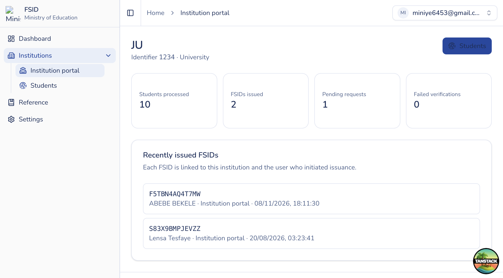

# Institution portal home

## Purpose

Institution landing page with roster / issuance summary and a quick path into Students.

## Who sees it

Users with `institution:read` who are **not** MoE institution managers (`institutionPortalOnly` nav).

## How to open

Sidebar → **Institutions** → **Institution portal** (`/institution-portal`).

## Actions

1. Review stats and recent issued FSIDs for your institution.
2. Open **Students** (requires `institution:issue`) to manage the roster — see [Students](students.md).
