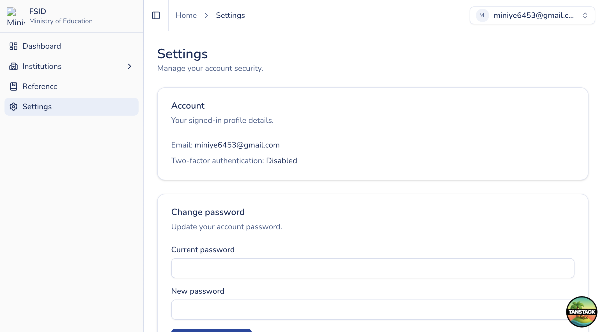

# Settings (institution)

## Purpose

Manage your own account password and 2FA while signed in as an institution user. Same Settings page as MoE staff; sidebar otherwise shows institution menus.

## Who sees it

All authenticated users.

## How to open

Sidebar → **Settings** (`/settings`).

## Actions

1. Review your account email and roles.
2. **Update password**.
3. Manage **2FA** according to your institution’s security policy.
