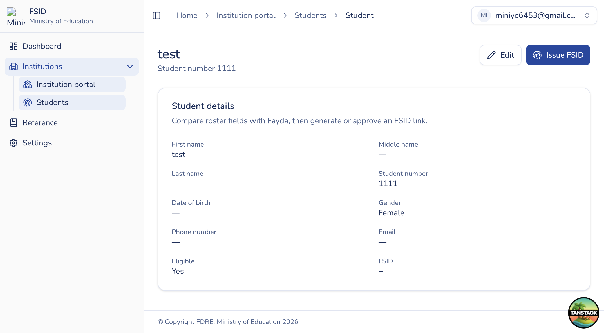

# Student detail and Issue FSID

## Purpose

Edit a roster record and run institution-channel Fayda issuance or approve a soft identity match to link an existing FSID.

## Who sees it

Institution users with access to Students (`institution:issue`).

## How to open

**Students** list → open a student (`/institution-portal/students/{id}`).

## Edit roster

1. Click **Edit**.
2. Update name parts, student number, date of birth, gender, phone, email, eligibility.
3. **Save**. Duplicate student numbers within your institution are rejected.

## Fayda identity card

When verification has run, the page shows verified name, date of birth, gender, Fayda subject, picture, and verified-at time stored on the student.

## Issue FSID

Shown when the student is eligible and does not already have an FSID.

1. Click **Issue FSID**.
2. Confirm consent and enter **FIN** when asked.
3. Complete Fayda verification.
4. Review the verified identity against the roster.
5. If it matches, **Generate FSID** (create or retrieve) and link to your institution.
6. If demographics differ, review the **similarity score** and use **Approve & link student** when you confirm it is the same person. There is no reject action on this soft-match path — leave without approving if you are unsure.

## Already has FSID

If the student already has an FSID, the Issue control is hidden. Use the displayed FSID value and Fayda card for reference.
