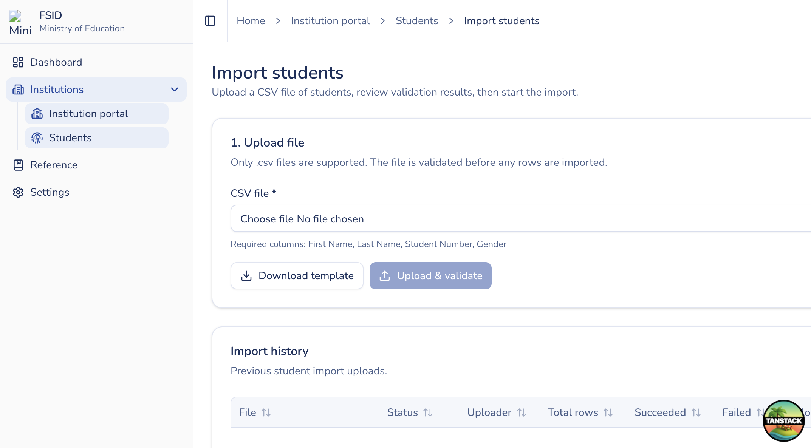

# Import students

## Purpose

Bulk create or update roster rows from a CSV file. Existing student numbers in your institution are **updated**; new numbers are **created**. Duplicate numbers inside the same file are reported as errors.

## Who sees it

Users with `institution:issue` (your institution only). MoE admins can run the same flow from an institution detail page for a chosen school.

## How to open

Students list → **Import CSV** (`/institution-portal/students/import`), or continue into an import detail (`.../import/{id}`).

## Steps

1. **Download template** to get the required headers and a sample row.
2. Fill rows: First Name, Middle Name (optional), Last Name, Student Number, Gender (Male/Female), Date of Birth (`YYYY-MM-DD`), Phone, Email, Eligible (Yes/No).
3. **Upload** the CSV. Validation runs asynchronously.
4. Review **preview** and **errors** (invalid rows, duplicates in file).
5. When validation succeeds, **Start** processing.
6. Watch **progress**; download the error CSV if some rows failed.
7. Return to **Students** to confirm imported records.

## Rules

- Imports are bound to **your membership institution** (or the institution selected by an MoE admin).
- `(institution, student number)` is unique — the same number cannot exist twice in one school.
- Uploader is recorded for audit (`uploadedBy` / createdBy on new rows).
