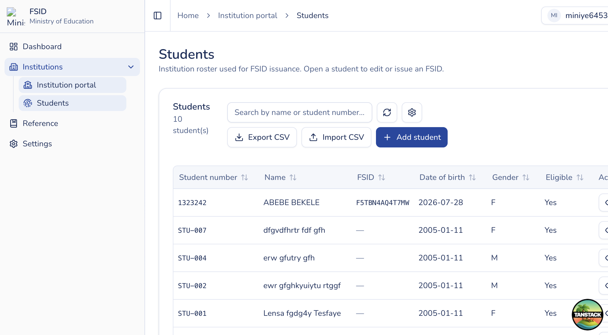

# Students

## Purpose

Maintain your institution’s student roster: search, add, export, import, and open a student for editing or NSID issuance.

## Who sees it

Users with `institution:issue` (institution portal only).

## How to open

Sidebar → **Institutions** → **Students** (`/institution-portal/students`).

## Actions

1. **Search** by name or student number; **reload** when needed.
2. **Add student** — enter name parts, student number, date of birth, gender, optional phone/email, eligibility. Student number must be unique within your institution.
3. **Export CSV** — choose fields, with/without NSID, and optional issued-date range, then download.
4. **Import CSV** — opens the import wizard; see [Import students](student-import.md).
5. Open a student row to view/edit and issue — see [Student detail and Issue NSID](student-detail-issue.md).

## Notes

- **Issue NSID** is available on the student detail page when the student is eligible and does not already have an NSID linked.
- Export and list data never leave your institution’s scope.
